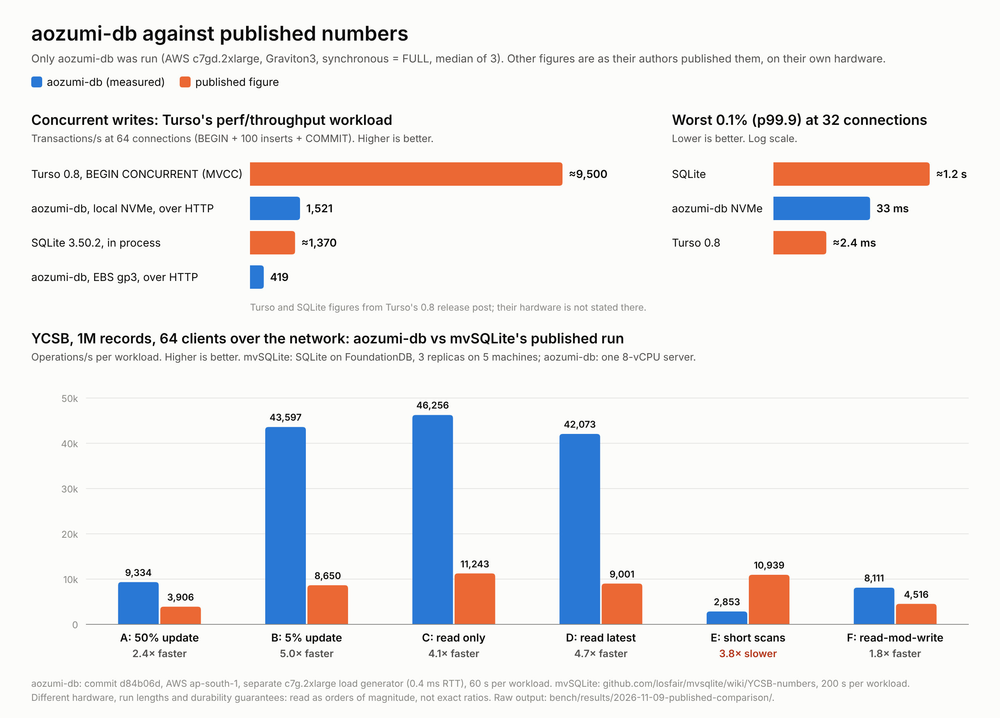

# Benchmarks

aozumi-db is measured with standard workloads, over HTTP, the way clients
use it:

- **YCSB core workloads A–F**: the common benchmark for databases served
  over a network. Ten 100-byte fields per record, Zipfian key popularity,
  the standard read/update/insert/scan mixes (see
  `examples/bench/ycsb.rs`). Closed loop: each client sends its next
  request as soon as the last returns.
- **Open-loop write latency**: single-row write transactions arriving on a
  fixed schedule, timed from when each was due, so time spent queued behind
  another writer counts (no coordinated omission).
- **Micro**: point reads, single-row inserts and 100-row transactions, and
  the bare storage engine's point-read rate on one thread, to show how
  much the server adds.

```bash
cargo run --release --example bench -- ycsb ABCDEF --records 100000 --clients 32 --seconds 10
cargo run --release --example bench -- latency --rate 1000 --clients 32 --seconds 10
cargo run --release --example bench -- micro --clients 32 --seconds 5
# as production runs it: checked tokens, backups, the WAL shipped every 5 s
cargo run --release --example bench -- micro --clients 32 --seconds 5 --prod
# a server elsewhere
cargo run --release --example bench -- micro --url https://db.example.com --token "$TOKEN"
```

The server runs in the benchmark process on 4 threads and the clients on
2, on the same machine, so numbers compare across runs on one machine,
not across machines. Next to add: TATP, the OLTP benchmark used in the
SQLite VLDB paper, to compare against the engine's own embedded numbers.

## Results

Machine: Apple A18 Pro laptop, 6 cores, 8 GB RAM, macOS, shared with other
apps (load average 4 to 13 during these runs, swap in use). Expect
run-to-run swings of 20 to 50% on this machine; only large differences, or
differences repeated in paired runs, mean anything. 100,000 records (about
100 MB), 32 clients, 10 s per workload.

### Baseline (2026-10-26, before tuning)

| YCSB | ops/s | p50 | p99 | p99.9 |
|---|---:|---:|---:|---:|
| A (50% update) | 2,042 | 1.14 ms | 326.02 ms | 1,346.51 ms |
| B (5% update) | 18,428 | 1.49 ms | 6.74 ms | 17.86 ms |
| C (read only) | 16,498 | 1.65 ms | 7.19 ms | 15.85 ms |
| D (read latest, 5% insert) | 12,095 | 1.93 ms | 12.46 ms | 40.76 ms |
| E (short scans, 5% insert) | 3,222 | 8.34 ms | 35.82 ms | 103.48 ms |
| F (read-modify-write) | 2,386 | 0.60 ms | 286.54 ms | 1,321.31 ms |

| open-loop writes | completed | p50 | p90 | p99 | p99.9 | max |
|---|---:|---:|---:|---:|---:|---:|
| 1000/s, 32 connections | 1000/s | 2.04 ms | 211.08 ms | 1,102.76 ms | 1,454.33 ms | 1,716.81 ms |

| micro | ops/s | p50 | p99 | p99.9 |
|---|---:|---:|---:|---:|
| point read | 32,468 | 0.95 ms | 1.96 ms | 5.73 ms |
| single-row insert | 1,870 | 0.47 ms | 378.91 ms | 1,468.99 ms |
| 100-row transaction | 525 | 3.02 ms | 340.89 ms | 1,372.51 ms |

Bare engine, one thread, same point read: 144,196 ops/s.

What the baseline shows: concurrent writers race for the database's single
write lock, and the losers sleep in SQLite-style backoff (1 ms rising to
100 ms per retry), so write tails reach seconds even at 1,000 writes/s.

### After tuning (2026-10-26)

Changes: writers queue per database instead of racing for the write lock;
connections are pooled; compiled statements are cached per connection;
commits no longer checkpoint the WAL inline (a background checkpointer does).
Run at load average 4.4.

| YCSB | ops/s | p50 | p99 | p99.9 | vs baseline |
|---|---:|---:|---:|---:|---|
| A (50% update) | 13,955 | 0.40 ms | 21.64 ms | 26.10 ms | 6.8x ops/s, p99.9 52x lower |
| B (5% update) | 34,455 | 0.85 ms | 1.96 ms | 20.35 ms | 1.9x |
| C (read only) | 36,413 | 0.86 ms | 1.70 ms | 2.02 ms | 2.2x |
| D (read latest, 5% insert) | 31,485 | 0.88 ms | 5.43 ms | 17.27 ms | 2.6x |
| E (short scans, 5% insert) | 4,287 | 6.91 ms | 19.62 ms | 44.93 ms | 1.3x |
| F (read-modify-write) | 12,224 | 0.41 ms | 24.03 ms | 28.62 ms | 5.1x ops/s, p99.9 46x lower |

| micro | ops/s | p50 | p99 | p99.9 | vs baseline |
|---|---:|---:|---:|---:|---|
| point read | 53,747 | 0.58 ms | 1.17 ms | 1.44 ms | 1.7x |
| single-row insert | 12,677 | 2.39 ms | 6.12 ms | 9.23 ms | 6.8x ops/s, p99.9 159x lower |
| 100-row transaction | 2,726 | 2.67 ms | 6.76 ms | 13.51 ms | 5.2x |

Bare engine, one thread, same point read, same run: 148,027 ops/s.

| open-loop writes, 1000/s, 32 connections | p50 | p90 | p99 | p99.9 | max |
|---|---:|---:|---:|---:|---:|
| baseline | 2.04 ms | 211.08 ms | 1,102.76 ms | 1,454.33 ms | 1,716.81 ms |
| writer queue | 2.00 ms | 3.31 ms | 43.99 ms | 74.15 ms | 82.73 ms |
| all changes, 3 runs at load 9.3 | 0.91–1.44 ms | 1.59–2.09 ms | 6.81–34.74 ms | 18.14–99.21 ms | 19.94–104.30 ms |

Paired runs (alternating, three pairs, 5 s each) isolate connection and
statement reuse: YCSB C median 32.7k vs 22.7k ops/s (+44%), YCSB A median
12.5k vs 9.3k (+35%), better in every pair. The background checkpointer
consistently lowers open-loop p50 (about 1.0 ms vs 1.6–1.9 ms in paired
runs); its effect on p99 is within this machine's noise.

What is left on the table: the server reaches about a third of the bare
engine's single-thread point-read rate on a shared 6-core laptop where the
clients run too. Next: a quiet machine for numbers worth publishing, TATP,
and profiling the read path (JSON encoding, the blocking-pool hop).

## The path apps use (2026-11-04)

The numbers above run client and server in one process. What an app sees
also includes the network in front of the server. Two probes measure it with
the requests `@libsql/client` sends (`POST /v2/pipeline` with `execute` and
`close`), one request at a time over a kept-alive connection:

- `bench/probe/pipeline-latency.mjs` (Node's `fetch`): from where an app
  runs.
- `bench/probe/pipeline-latency.py` (Python's standard library only): on the
  server's own machine, against its loopback, to see the server alone.

Both use one table of 10,000 rows (`--setup` makes it) and print JSON.

AOZUMI's hosted server, release 289c07c: a 2-vCPU ARM VM (AWS t4g.small,
EBS gp3, ext4) behind a Cloudflare tunnel. The app side was a 0.5-vCPU ARM
container (AWS Fargate) in the same availability zone, Node 22. The VM was
idle (load 0.00) with one database.

| Per request, ms | from the app, p50 / p99 | on the server's loopback, p50 / p99 | network's share of p50 |
|---|---:|---:|---:|
| `GET /health` | 11.33 / 26.07 | 0.17 / 0.28 | 11.2 |
| point read | 10.90 / 16.87 | 0.30 / 0.41 | 10.6 (97%) |
| single-row insert | 14.03 / 32.19 | 3.57 / 4.35 | 10.5 (75%) |
| 10-row transaction | 13.85 / 18.45 | 3.69 / 4.91 | 10.2 (73%) |
| point reads, 8 clients, 10 s | 594 ops/s, p50 10.9, p99 57.8 | | |

What this shows:

- **The tunnel is most of every request.** A point read takes 0.30 ms on the
  server and 10.9 ms from the app, and 8 clients get 594 reads/s. A path
  inside the network, without the tunnel, is where most of the time is.
- **Writes are a flush.** A commit of one row costs what a commit of ten does
  (3.57 vs 3.69 ms). With `synchronous = FULL`, each commit waits for the
  disk.

A flush on that volume, 200 writes of one 4,120-byte WAL frame each:

| Pattern | p50 | p99 |
|---|---:|---:|
| append + `fsync` (the WAL grows after each truncating checkpoint) | 3.05 ms | 3.32 ms |
| overwrite in place + `fsync` | 2.81 ms | 3.05 ms |
| append + `fdatasync` | 3.02 ms | 3.41 ms |
| overwrite in place + `fdatasync` | 0.94 ms | 1.06 ms |

Every commit appends to the WAL, and flushing an append also commits the
file system's journal: the 3 ms rows. `fdatasync` skips that only for an
overwrite, and the engine never overwrites the WAL: it empties the file at a
truncating checkpoint, and after a restarting one it cuts it back to its
header at the next write. So the server cannot get the 0.94 ms row by
itself, and syncing with `fdatasync` instead changes nothing (below).

### The write path on the server's kind of volume (2026-11-04)

What does shorten an append's flush is the file system. A throwaway machine
of the same kind as AOZUMI's (AWS Graviton2, 2 vCPUs, Ubuntu 24.04 with
kernel 7.0, EBS gp3, ext4 `noatime`) had two identical 20 GB volumes, one
plain ext4 and one formatted with ext4's `fast_commit`, which journals a
small change such as an append in a block of its own. On each, the flush
probe, then `micro --clients 8 --seconds 5` and `latency --prod`, built from
this tree, two rounds:

| | plain ext4 | ext4 `fast_commit` | change |
|---|---:|---:|---:|
| flush, append + `fsync`, p50 | 2.91 / 2.92 ms | 1.88 / 1.88 ms | −35% |
| flush, append + `fdatasync`, p50 | 2.96 / 2.92 ms | 1.88 / 1.86 ms | −36% |
| flush, overwrite + `fdatasync`, p50 | 0.96 / 0.94 ms | 0.97 / 0.96 ms | none |
| single-row inserts/s, 8 clients | 308 / 309 | 471 / 470 | +53% |
| 100-row transactions/s, 8 clients | 249 / 250 | 352 / 352 | +41% |
| point reads/s, 8 clients | 19,378 / 19,205 | 20,092 / 19,192 | none |
| one writer at 100 commits/s, p50 / p99 | 4.40 / 5.15 ms, 4.39 / 5.15 ms | 3.59 / 4.21 ms, 3.54 / 4.22 ms | −19% / −18% |
| one writer at 100 commits/s, p99.9 | 15.66, 8.62 ms | 5.30, 5.82 ms | about −55% |
| 8 connections at 200 commits/s, p50 / p99 | 4.97 / 6.07 ms, 4.36 / 5.43 ms | 3.05 / 3.83 ms, 3.02 / 3.70 ms | −35% / −34% |

A trial build that synced the WAL with `fdatasync` instead of `fsync`
landed within a few percent of these numbers on both volumes (308 inserts/s
on plain ext4, 467 to 472 on `fast_commit`), so the server keeps `fsync`.
`fast_commit` is a setting of the volume, not of the server; durability is
the same, as each `fsync` still returns only once the commit is on the disk.

The YCSB harness runs the server in dev mode by default: no token check, no
backups. `--prod` runs it with production's settings instead (checked
tokens, backups with the WAL shipped every 5 s), and `--url … --token …`
points it at a server elsewhere.

### The direct path (2026-11-04)

`AOZUMI_DB_TLS_LISTEN` (DESIGN D27) lets apps in the same network skip the
tunnel. A throwaway server built from that change ran on the same kind of
VM as AOZUMI's (Graviton2, 2 vCPUs, Ubuntu 24.04, EBS gp3), with
production's settings: checked tokens, the WAL shipped every 5 s, backups to
a local directory instead of S3, and no request rate limit. It had a
self-signed ECDSA P-256 certificate. The app side was the same Fargate
placement as above (0.5 vCPU, Node 22), reaching the server's private
address directly. The probe skipped certificate checks, which cost nothing
per request on a kept-alive connection.

| Per request, p50 | through the tunnel (above) | direct, 0.5 vCPU, 2 rounds | direct, 2 vCPUs |
|---|---:|---:|---:|
| `GET /health` | 11.33 ms | 0.53 / 0.52 ms | 0.37 ms |
| point read | 10.90 ms | 0.67 / 0.71 ms | 0.51 ms |
| single-row insert | 14.03 ms | 3.85 / 4.09 ms | 3.82 ms |
| 10-row transaction | 13.85 ms | 3.90 / 4.17 ms | 3.91 ms |
| point reads, 8 clients, 10 s | 594/s | 1,743 / 854/s | 6,802/s |
| point read, p99 | 16.87 ms | 22.8 / 42.7 ms | 3.31 ms |

- **Reads get 16 to 21 times faster, writes about 3.5 times.** What is left
  is the server's own time plus one hop in the zone. On the throwaway's
  loopback, a point read took 0.29 ms and an insert 3.54 ms, as on
  production's (0.30 and 3.57 ms).
- **TLS costs about 0.04 ms a request.** On that loopback, a point read took
  0.329 ms over HTTPS and 0.286 ms over plain HTTP.
- **On a 0.5-vCPU client, the tail and the 8-client rate are the client's.**
  At 15 times the requests a second it uses up its CPU share. The same
  probe with 2 vCPUs had a p99 of 3.3 ms and 6,802 reads a second.

## Against published numbers (2026-11-09)

There is no official public benchmark for SQLite or for SQLite servers, and
no neutral table that sets them side by side. What exists is papers, vendor
posts and blog figures, each on its own workload and hardware. The two below
publish their method in full and sit closest to what aozumi-db is, so
aozumi-db was run with the same workload settings as each, and only
aozumi-db was run: the other numbers are as published.

**Machines:** AWS ap-south-1a. The server was a c7gd.2xlarge (8 Graviton3
vCPUs), with data on its local NVMe drive or on a 40 GB gp3 volume (the kind
AOZUMI's production uses), both ext4 with `fast_commit`, mounted `noatime`.
For YCSB, the load came from a second c7g.2xlarge in the same subnet (0.4 ms
round trip). aozumi-db `d84b06d`, at its default durability
(`synchronous = FULL`). Three repeats of each test, medians below. Raw
output is in `bench/results/2026-11-09-published-comparison/`.



### Turso's concurrent-write benchmark

The workload of [tursodatabase/turso `perf/throughput`](https://github.com/tursodatabase/turso/tree/main/perf/throughput),
the benchmark behind Turso 0.8's concurrent-write numbers, run as `bench
writes`:

- `test_table(id INTEGER PRIMARY KEY, data TEXT)`;
- each transaction is `BEGIN`, 100 inserts with ids from one shared counter,
  then `COMMIT`, with `synchronous = FULL`;
- a closed loop per connection, swept over 1 to 64 connections, 30 s per step
  after a 3 s warmup;
- the sweep order alternated between repeats, and the page cache was dropped
  between them.

aozumi-db is reached over HTTP with libSQL's protocol, one request per
transaction. Turso and SQLite run in process.

| transactions/s (p99.9) | 1 | 8 | 32 | 64 |
|---|---:|---:|---:|---:|
| **aozumi-db, local NVMe** | 795 (3.8 ms) | **1,820** (10 ms) | 1,587 (**33 ms**) | **1,521** (67 ms) |
| aozumi-db, gp3 | 319 (13 ms) | 419 (33 ms) | 420 (90 ms) | 419 (166 ms) |
| SQLite (published) | | | (about 1.2 s) | about 1,370 |
| Turso 0.8, `BEGIN CONCURRENT` (published) | | | (about 2.4 ms) | about 9,500 |

The SQLite and Turso figures are from Turso's [0.8 release post](https://turso.tech/blog/turso-0.8.0)
(SQLite 3.50.2), as summarised by a web search. Its hardware is not known
here. The post itself was not readable from the machine that wrote this.

- **Against SQLite:** about the same throughput at 64 connections (1.1
  times), and a worst 0.1% about 36 times shorter at 32 connections, with no
  failures in any run. Both commit one transaction per flush; aozumi-db's
  writers take turns in order (D19), while SQLite's busy handler leaves some
  writers sleeping for a second.
- **Against Turso 0.8: about 6 times fewer transactions.** Turso runs
  transactions concurrently (MVCC, `BEGIN CONCURRENT`) and serialises them
  only at commit. aozumi-db runs one writer at a time and flushes once per
  commit. Group commit, where the commits queued behind one flush share the
  next, is the step that closes most of this gap.
- **On gp3 the disk sets the rate.** A flush takes about 2.4 ms, so about 420
  commits a second whatever the connection count, and the queue time grows
  with each connection added.

### mvSQLite's YCSB numbers

[mvSQLite's published YCSB run](https://github.com/losfair/mvsqlite/wiki/YCSB-numbers):
SQLite on FoundationDB, served over the network. 1,000,000 records, 64
threads, go-ycsb on its own c6i.2xlarge, 200 s per workload. The backend was
3 × i4i.large running FoundationDB with double replication, plus a
c5.2xlarge for mvstore. aozumi-db ran the same core workloads with the same
record count, client count and separate load generator, through `bench
ycsb` (Zipfian 0.99, ten 100-byte fields), for 60 s per workload, against
one server.

| ops/s | aozumi-db | mvSQLite (published) | |
|---|---:|---:|---|
| A: 50% update | 9,334 | 3,906 | 2.4 times |
| B: 5% update | 43,597 | 8,650 | 5.0 times |
| C: read only | 46,256 | 11,243 | 4.1 times |
| D: 5% insert, latest | 42,073 | 9,001 | 4.7 times |
| E: 95% short scans | 2,853 | 10,939 | **0.26 times** |
| F: read-modify-write | 8,111 | 4,516 | 1.8 times |

mvSQLite's numbers are its per-operation rows added up (A: read + update; F:
read + read-modify-write). aozumi-db had no failures. Per operation on
workload A, the p99 was 0.25 ms for reads and 21 ms for updates; mvSQLite
published 40 ms and 77 ms.

- **Faster on everything but scans.** Reads, updates and inserts are 1.8 to 5
  times mvSQLite's throughput, with far shorter tails.
- **Scans are about 4 times slower.** Workload E reads 1 to 100 rows per
  operation, and aozumi-db encodes every row as libSQL's JSON. This is the
  read path's known cost (see "The path apps use" above), and the next thing
  to profile: protocol v3 (binary, cursors) and row encoding.
- **mvSQLite does something aozumi-db does not:** every commit is replicated
  across three machines, so it survives losing one. aozumi-db is one server
  that flushes to its own disk, with backups shipped every 5 s. The two
  setups also differ in their machines (one 8-vCPU server against five) and
  in run length (60 s against 200 s).

### Not compared

- **rqlite** publishes only a range: about 10 to over 200 single-row inserts
  a second on a 3-node Raft cluster, or about 220 in one blog test.
- **Cloudflare D1, Turso Cloud and Neon** have no neutral published
  benchmark. Their latency figures in blogs disagree with one another, and
  depend on where the client is.
- **SQLite's own TATP numbers** (*SQLite: Past, Present, and Future*, VLDB
  2022) and its `speedtest1` cycle counts are published on vldb.org and
  sqlite.org, which the machine that wrote this could not reach.

## Head-to-head on a dedicated machine: aozumi-db, libSQL's server and SQLite (2026-11-08)

The first numbers here from a quiet, dedicated machine of the kind AOZUMI
runs on. `bench/head-to-head.sh` ran five contenders through the same YCSB
workloads and the same open-loop write run, three rounds, the order rotated
each round:

- **aozumi-db**, this branch, at its default durability (`synchronous =
  FULL`, which production runs) and at `NORMAL`.
- **libSQL's server** (`sqld` 0.24.32, its defaults, which are `NORMAL`).
- **SQLite 3.46.0 embedded**: the same statements on SQLite's C library in
  the benchmark process (`bench ycsb-sqlite`), one WAL connection per
  client thread, 5 s busy timeout, `FULL` and `NORMAL`. It has no network,
  protocol or server, so it is the ceiling an embedded app gets.

The servers were reached over HTTP with libSQL's protocol, from the same
machine. 100,000 records, 32 clients, 20 s per workload.

**Machine:** AWS c7g.2xlarge (8 Graviton3 vCPUs, not burstable), Ubuntu 24.04
(kernel 7.0), ap-south-1. Data on its own 40 GB gp3 volume, ext4 with
`fast_commit`, mounted `noatime`, like production's.

Medians of the three rounds. Raw output: `bench/results/2026-11-08-head-to-head/`.

| ops/s (p99.9) | aozumi-db FULL | aozumi-db NORMAL | sqld (NORMAL) | SQLite FULL | SQLite NORMAL |
|---|---:|---:|---:|---:|---:|
| A: 50% update | 1,046 (137 ms) | 11,365 (434 ms) | 102 (106 ms) | 1,011 (3,334 ms) | 55,996 (104 ms) |
| B: 5% update | 10,233 (70 ms) | 44,145 (4 ms) | 48 (15 ms) | 9,448 (933 ms) | 123,468 (37 ms) |
| C: read only | 44,234 (2 ms) | 43,784 (2 ms) | 3,636 (26 ms) | 179,037 (1 ms) | 181,524 (1 ms) |
| D: 5% insert, latest | 9,541 (78 ms) | 41,522 (7 ms) | 51 (18 ms) | 8,379 (1,034 ms) | 137,220 (37 ms) |
| E: 95% short scans | 3,670 (26 ms) | 3,699 (27 ms) | 56 (31 ms) | 8,004 (831 ms) | 8,840 (12 ms) |
| F: read-modify-write | 1,025 (77 ms) | 10,429 (334 ms) | 4 (18 ms) | 990 (3,534 ms) | 34,312 (79 ms) |
| failed operations, all rounds | 0 | 0 | 990, mostly timeouts | 82 (busy) | 0 |

| Open-loop writes, 1,000 tx/s, 32 connections | p50 | p99 | p99.9 | rounds completed |
|---|---:|---:|---:|---:|
| aozumi-db FULL | 8,948 ms | 17,733 ms | 17,894 ms | 3 of 3 |
| aozumi-db NORMAL | 1.13 ms | 1.72 ms | 5.35 ms | 3 of 3 |
| sqld | (no result) | | | 0 of 3: the client failed once and the server stalled twice |

What this shows:

- **Against libSQL's server, at the same durability (`NORMAL`):** about 110
  times the throughput on A, 12 times on reads, and no failures. `sqld`
  timed out on every workload with writes. In the open-loop run it never
  produced a result: once the client failed against it, twice it stopped
  answering. One stalled server, stopped after 15 minutes, was at 618% CPU
  with 3,855 threads. On a second machine (below) the same run made `sqld`
  hit its 4,096-thread cap and abort.
- **Against embedded SQLite at `FULL`:** the same write throughput (A 1,046
  against 1,011 ops/s: both wait for the disk once per commit), with the
  worst 0.1% of requests 24 times shorter (137 ms against 3,334 ms) and no
  failures. SQLite's busy handler lets an unlucky writer sleep and retry
  for seconds; aozumi-db's writers queue in order (D19). This is what the
  queue buys.
- **Against embedded SQLite at all:** an embedded library is faster per
  operation, about 4 times on reads and 5 on writes at `NORMAL`, because a
  server pays for HTTP, JSON and a hop to the blocking pool on every
  request. That is the cost of being a server, not of the engine.
- **`FULL` cannot keep up with 1,000 commits a second on this volume, and
  the queue then grows without bound.** Each commit waits for its own flush
  (about 2 ms on gp3 with `fast_commit`), so one database commits about 500
  times a second at `FULL`. Offered 1,000 a second for 20 s, every commit
  was eventually made, but the median waited 9 s and the slowest 18 s.
  Two changes follow: a deadline and a cap on the writer queue, so an
  overloaded database answers busy at once instead of making everyone wait;
  and group commit, so the commits queued behind one flush share the next.
- **`NORMAL`'s A and F have a long tail** (p99.9 334 to 434 ms against p99
  3 to 4 ms), the same three rounds running. A WAL checkpoint is the likely
  cause; not yet investigated.

### The same run on a shared cloud container (2026-11-08)

The same script on a 4-vCPU x86_64 cloud container shared with other work,
the disk unknown: a second data point, not a published number. Medians of
three rounds (`local-raw.md`):

| ops/s (p99.9) | aozumi-db FULL | aozumi-db NORMAL | sqld | SQLite FULL | SQLite NORMAL |
|---|---:|---:|---:|---:|---:|
| A | 3,029 (48 ms) | 11,548 (38 ms) | 378 (316 ms) | 9,667 (1,031 ms) | 42,483 (104 ms) |
| C | 25,396 (21 ms) | 23,981 (28 ms) | 2,698 (50 ms) | 120,368 (5 ms) | 121,667 (5 ms) |
| open-loop 1,000 tx/s, p99 | 15.85 ms | 4.56 ms | crashed in round 2, stalled in round 3 | | |

This disk makes a flush much cheaper than gp3 does (SQLite `FULL` A reaches
9,667 ops/s here against 1,011 there), so `FULL` keeps up with the
open-loop run here. In round 2, `sqld` reached its 4,096-thread cap and
aborted (`local-sqld-crash-round2.log`).

## Head-to-head with libSQL's server (2026-10-26)

`bench/head-to-head.sh` runs the same YCSB and open-loop client against
libSQL's own server (`sqld` 0.24.32, default settings, one local database)
and aozumi-db, each on a fresh empty directory, alternating the order per
round. aozumi-db is run twice: with its default durability (`synchronous =
FULL`) and with `AOZUMI_DB_SYNCHRONOUS=normal`, which is what `sqld` uses.
Raw output, medians and charts: `bench/results/2026-10-26-head-to-head/`.

Two rounds completed (the third was stopped), at load average 6 to 37, so
read these as large-gap results only.

| YCSB, 32 clients, 100k records | aozumi-db | aozumi-db (normal) | libSQL server, per round |
|---|---:|---:|---:|
| A (50% update) | 13,512 ops/s | 10,215 | 944 / 1,103, plus 57 / 34 refused busy |
| B (5% update) | 34,272 | 26,885 | 4,582 / 1,895 (stalled in round 2) |
| C (read only) | 37,436 | 35,416 | 4,358 / 3,510 |
| A p99 | 9.29 ms | 19.95 ms | 85.96 / 108.47 ms |

What happened on libSQL's server: under 32 concurrent clients it refuses
some writes with `SQLITE_BUSY`, and in every round it then stopped answering
altogether: all 32 clients timed out (10 s) from workload D or earlier, and
an earlier run stayed stuck for over an hour with the server spinning on 5
cores in its write-lock acquire path. Its D, E, F and open-loop numbers
therefore measure that stall, not its speed, and are left out above.
aozumi-db refused nothing and timed out nothing: writers queue per database
instead of racing for the lock.

Not yet done: a quiet machine, more rounds, and `sqld` tuning beyond its
defaults.
